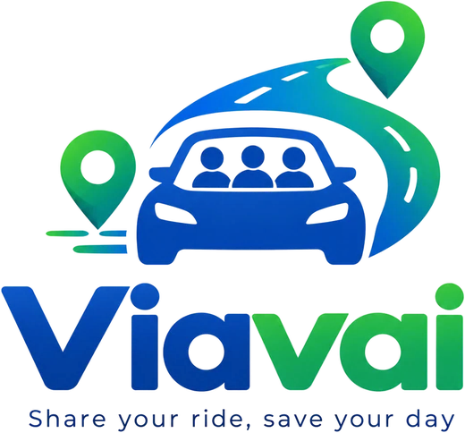

  

Documentazione del progetto Viavai, un'applicazione web di carpooling per gli spostamenti quotidiani brevi, che mette in contatto passeggeri e conducenti che fanno la stessa strada ogni giorno, per dividere le spese del viaggio.

Sviluppato da:

- Meriame Benantar, 1087369
- Zineb Machal, 1100565
- Zineb Chakraoui, 1086381

 

Corso di Ingegneria del Software, A.A. 2026/2027, Università degli Studi di Bergamo. 
Docente: prof. Angelo Gargantini. Esercitatrice: Silvia Bonfanti.

Storico delle versioni:

| Versione | Modifiche |
|---|---|
| 0.1 | Struttura del documento con i capitoli |
| 0.2 | Aggiunti introduzione, gestione del progetto, raccolta dei requisiti e requisiti funzionali |
| 0.3 | Aggiunto il glossario con le definizioni dei termini principali |

# INDICE
0. [Definizioni e abbreviazioni](#definizioni-e-abbreviazioni)
1. [Introduzione](#1-introduzione)
2. [Gestione del progetto](#2-gestione-del-progetto)
3. [Requisiti](#3-requisiti)
4. [Design](#4-design)
5. [Testing](#5-testing)
6. [Manutenzione](#6-manutenzione)

## Definizioni e abbreviazioni

| Termine | Significato |
|---|---|
| Visitatore | Chi usa Viavai senza avere un account. Può solo cercare i passaggi e registrarsi. |
| Utente registrato | Chi ha un account e ha scelto se essere conducente o passeggero. |
| Conducente | Utente registrato che offre un passaggio con la sua auto e decide chi accettare. |
| Passeggero | Utente registrato che cerca un passaggio e chiede un posto al conducente. |
| Passaggio | Il viaggio che un conducente offre: da una zona di partenza a una di arrivo, a una certa ora e in certi giorni della settimana. Si pubblica una volta sola e vale ogni settimana. |
| Prenotazione | La richiesta di un posto su un passaggio. Ha uno stato: richiesta, confermata, in corso, completata, rifiutata, annullata o scaduta. |
| Zona | Un'area di Bergamo o di un comune vicino (per esempio Seriate, Dalmine, Treviolo o Città Alta), che si usa come partenza o arrivo. Per ogni coppia di zone salviamo la distanza in km. |
| Prezzo massimo | Il prezzo più alto che il conducente può chiedere a ogni passeggero. Lo calcoliamo come km × 0,20 € ÷ persone in auto, conducente compreso. |
| Posti liberi | I posti che il conducente offre su un passaggio. Al massimo sono i posti dell'auto meno uno, perché uno è il suo. |
| Condivisione delle spese | Il passeggero rimborsa al conducente una parte delle spese del viaggio, ma il conducente non ci deve guadagnare. |

| Abbreviazione | Significato |
|---|---|
| FUN | Requisito funzionale |
| GUI | Requisito dell'interfaccia grafica |
| MDA | Model Driven Architecture |

## 1. Introduzione
#### 1.1 Viavai
Viavai è un'applicazione web di carpooling per i tragitti brevi che si fanno tutti i giorni, come casa-università o casa-lavoro. Mette in contatto conducenti e passeggeri che fanno la stessa strada ogni giorno, così che possano dividersi le spese del viaggio.

**Perché Viavai.** L'idea nasce dalla nostra esperienza di studentesse pendolari: molte persone fanno ogni mattina la stessa strada da sole in macchina, mentre altre la fanno con i mezzi pubblici o cercano un passaggio. Le app che esistono già, come BlaBlaCar, sono pensate soprattutto per viaggi lunghi e occasionali, non per i tragitti brevi e ripetuti.

**Il committente.** Il progetto è customer-driven. Il committente è immaginario: il mobility manager dell'Università di Bergamo, cioè chi si occupa di come studenti e personale raggiungono le sedi. Ci ha spiegato che il parcheggio della sede di Dalmine è spesso pieno e che molti studenti arrivano da soli in auto dagli stessi comuni. Per questo ci chiede un'app per far condividere il viaggio ai pendolari.

**Un vincolo importante.** Viavai deve restare un servizio di condivisione delle spese e non diventare un servizio di trasporto a pagamento. Per questo il prezzo che un conducente può chiedere ha un limite massimo, calcolato dall'applicazione (vedi FUN.6 e FUN.7).

**L'utente tipo.** È uno studente o un giovane lavoratore che fa ogni giorno lo stesso tragitto. Per esempio Marco, 24 anni, studia Ingegneria a Dalmine e parte ogni mattina da Seriate: vorrebbe spendere meno di benzina dividendo il viaggio con altri studenti che fanno la sua stessa strada.

**La prima versione.** È pensata per l'area di Bergamo e permette di:

- registrarsi e accedere, scegliendo il ruolo di passeggero o di conducente;
- pubblicare un passaggio ricorrente (partenza, arrivo, orario, giorni della settimana, posti liberi, prezzo);
- cercare un passaggio e richiedere un posto;
- accettare o rifiutare le richieste, da parte del conducente;
- controllare in automatico che il prezzo non superi il massimo;
- ricevere notifiche quando cambia lo stato di una prenotazione;
- usare l'interfaccia in italiano e in inglese.

**Cosa non facciamo.** Abbiamo deciso di lasciare fuori dalla prima versione i pagamenti dentro l'app (il passeggero paga il conducente direttamente, in contanti), il GPS in tempo reale durante il viaggio, un'app mobile nativa (Viavai è un'applicazione web, che però si adatta anche allo schermo del telefono) e i servizi esterni di mappe.

**Le zone.** Non usando le mappe, non calcoliamo le distanze in modo dinamico. Abbiamo diviso Bergamo e i comuni vicini in un certo numero di zone (per esempio Seriate, Dalmine, Treviolo, Città Alta) e salviamo nel database la distanza in km tra ogni coppia di zone. Da questa distanza parte il calcolo del prezzo massimo.

#### 1.2 Struttura del documento
Questo documento raccoglie tutta la documentazione del progetto, tranne il project plan, che è un documento a parte. Come nel documento del ventilatore polmonare visto a lezione, inizia con le definizioni e le abbreviazioni usate ed è diviso in sei capitoli:

- **Definizioni e abbreviazioni:** i termini principali (per esempio passaggio, prenotazione, zona) e le sigle usate (FUN, GUI, NFR, MDA).
- **1. Introduzione:** cos'è Viavai e come è organizzato questo documento.
- **2. Gestione del progetto:** il ciclo di vita del software che abbiamo scelto, come gestiamo il codice con Git e GitHub e come ci organizziamo come team.
- **3. Requisiti:** come abbiamo raccolto i requisiti e l'elenco dei requisiti funzionali, dell'interfaccia e non funzionali, con la qualità del software.
- **4. Design:** i diagrammi UML, l'architettura del software e i design pattern usati.
- **5. Testing:** i casi di test e la copertura dei test.
- **6. Manutenzione:** il refactoring fatto durante il progetto.

Ogni requisito ha un identificativo (FUN.1, GUI.1, NFR.1) e nelle tabelle sono indicati i requisiti da cui dipende, così ognuno si può ritrovare nel design e nei test.

## 2. Gestione del progetto
#### 2.1 Ciclo di vita del software

Abbiamo scelto un modello di sviluppo incrementale e iterativo, organizzato in quattro sprint.

È incrementale perché ogni sprint aggiunge una parte del sistema, e alla fine di ognuno abbiamo una versione che funziona, anche se incompleta. È iterativo perché non chiudiamo una fase per sempre: quando il codice cambia, aggiorniamo anche i requisiti, i diagrammi e i documenti. Ci è sembrato adatto anche perché Spring Boot, JSP e Spring Security sono nuovi per noi: con una versione funzionante a ogni sprint ci accorgiamo presto dei problemi.

Non abbiamo scelto un modello completamente agile perché il corso chiede una documentazione completa (requisiti, diagrammi UML, architettura, test), che non vogliamo lasciare alla fine. Per questo i primi due sprint sono quelli più dedicati a requisiti, modellazione e progettazione.

Gli sprint seguono l'ordine in cui costruiamo il sistema: 1) requisiti, 2) modello e dati (classi e database), 3) servizi (logica, accesso e API REST), 4) interfaccia e test, con il completamento della documentazione.

Seguiamo in parte anche l'approccio MDA visto a lezione: dal diagramma delle classi in StarUML generiamo una prima versione delle classi Java, che poi completiamo a mano.

#### 2.2 Configuration management

Usiamo Git e GitHub per tenere tutto il lavoro sotto controllo di versione. Il repository è condiviso con i docenti (gli account garganti e silviabonfanti), e per le dipendenze del codice usiamo Maven.

Nel repository ci sono i documenti (cartella Documenti), con le immagini dei diagrammi (immagini) e i progetti StarUML (uml). Il project plan e questa documentazione hanno uno storico delle versioni all'inizio del file: ogni nuova versione viene salvata con un commit che spiega cosa è cambiato, e grazie a GitHub possiamo sempre tornare a una versione precedente se qualcosa va storto.

**Regole per i commit e i branch**

Il branch main contiene solo versioni che funzionano. Ogni nuova funzionalità del codice si sviluppa in un branch separato, e prima di entrare in main la pull request viene controllata da almeno un'altra di noi. La documentazione la scriviamo in Markdown direttamente su GitHub, un pezzo alla volta, con un commit per ogni parte.

I messaggi dei commit dicono in modo chiaro cosa è stato fatto, e nella descrizione scriviamo cosa abbiamo scritto o aggiornato. Se un lavoro ha una issue, scriviamo il suo numero nel commit (per esempio #3), così il commit compare nella issue. Facciamo commit e push spesso, almeno una volta al giorno quando lavoriamo, per non perdere lavoro.

Il codice generato da StarUML lo teniamo, dove possibile, separato da quello scritto a mano, e lo rigeneriamo solo dopo aver fatto commit delle modifiche, per non sovrascrivere il lavoro fatto a mano.

**Gestione delle modifiche**

Quando vogliamo cambiare qualcosa, per esempio un requisito o il project plan, seguiamo questi passi:

1. Proposta: chi vuole la modifica apre una issue su GitHub, spiegando cosa vuole cambiare e perché.
2. Valutazione: ne parliamo insieme e la approviamo solo se è necessaria e rispetta i requisiti, considerando anche quanto tempo richiede e quali parti già fatte tocca.
3. Implementazione: la modifica si fa seguendo le regole di sopra, e insieme al codice aggiorniamo anche la documentazione, i diagrammi e i test collegati.
4. Versione: il commit spiega cosa è cambiato e, se serve, cambiamo il numero di versione del documento.

**Issue e Kanban board**

Per organizzarci usiamo le issue e la Kanban board di GitHub Projects. Ogni attività è una issue, con una sola scheda sulla board, assegnata a chi la prende in carico. Le etichette sono bug, enhancement, documentation e question, più una di priorità (must have, should have, could have). Le colonne della board sono: must have, in progress, verifica e test, done e could have.

#### 2.3 Organizzazione del team

Siamo in tre: Meriame Benantar, Zineb Machal e Zineb Chakraoui. Non abbiamo una gerarchia e non abbiamo ruoli fissi: lavoriamo tutte su tutte le parti del progetto (requisiti, diagrammi, codice, test e documentazione), un po' come in un team agile. Ognuna di noi fa a turno l'analista, la progettista, la sviluppatrice e la tester.

All'inizio di ogni sprint decidiamo insieme le attività e ognuna prende quelle che riesce a fare in quel momento. Per i requisiti e per i diagrammi ci siamo divise le parti (vedi il capitolo 3 e il README della cartella uml), ma poi controlliamo tutte il lavoro delle altre, così all'orale sappiamo spiegare tutto. Il diagramma delle classi lo facciamo insieme, perché è la base di tutto. Il lavoro di ognuna si vede dalla cronologia dei commit e dalle issue su GitHub.

Per i requisiti il nostro riferimento è il committente, cioè il mobility manager immaginario dell'Università di Bergamo, e a turno una di noi fa la sua parte. Per tutto il resto il riferimento sono i docenti del corso, che approvano il progetto. 

Per comunicare usiamo un gruppo WhatsApp, con cui ci organizziamo giorno per giorno. Le discussioni su una singola attività le scriviamo nei commenti della issue, e quando serve decidere qualcosa insieme facciamo una breve videochiamata. Non abbiamo riunioni fisse ogni settimana.

Secondo le indicazioni del corso ognuna dovrebbe dedicare al progetto circa 30-40 ore, quindi in totale prevediamo tra le 90 e le 120 ore.

## 3. Requisiti
#### 3.1 Raccolta dei requisiti
La raccolta dei requisiti segue il processo visto a lezione: elicitazione, specifica, validazione e negoziazione con il committente. Lo ripetiamo a ogni sprint.

**Il committente.** Il committente è immaginario: il mobility manager dell'Università di Bergamo, cioè chi si occupa di come studenti e personale raggiungono le sedi. Ci ha spiegato che il parcheggio della sede di Dalmine è spesso pieno e che molti studenti arrivano da soli in auto dagli stessi comuni. Per questo chiede un'app per far condividere il viaggio ai pendolari, a patto che resti una condivisione delle spese e non un servizio a pagamento. A turno una di noi fa la parte del committente.

**Come abbiamo raccolto i requisiti.**

- interviste al committente e scenari d'uso, che poi sono diventati i casi d'uso (vedi sezione 4.1);
- la nostra esperienza di studentesse pendolari;
- il confronto con app già esistenti, come BlaBlaCar;
- brainstorming tra di noi.

Per evitare ambiguità abbiamo preparato un glossario con i termini principali (vedi "Definizioni e abbreviazioni").

**Priorità.** Usiamo il metodo MoSCoW:

- *Must have:* i requisiti FUN.1–13, tutti i requisiti dell'interfaccia (GUI) e quelli non funzionali (NFR).
- *Should have:* FUN.14 e FUN.15, cioè l'annullamento di un passaggio e la scadenza delle richieste.
- *Won't have:* cose che abbiamo valutato ma che non faremo: i pagamenti dentro l'app (il passeggero paga il conducente direttamente, in contanti), il GPS in tempo reale durante il viaggio, un'app mobile nativa e i servizi esterni di mappe.

Le idee nuove vanno sulla board come *could have* e non entrano nella prima versione.

**Validazione.** Alla fine di ogni sprint il committente rilegge i requisiti e li approva.

#### 3.2 Requisiti funzionali

##### 3.2.1 Registrazione e accesso

| ID | Requisito / Motivazione | Dipende da |
|---|---|---|
| FUN.1 | Il visitatore deve poter registrarsi inserendo nome, cognome, email e password. L'email non può essere già usata da un altro utente. *Motivazione:* per offrire o prenotare un passaggio serve un account personale, e l'email permette di riconoscere l'utente. | – |
| FUN.2 | Durante la registrazione l'utente deve scegliere il proprio ruolo: conducente o passeggero. Un utente ha un solo ruolo. *Motivazione:* il ruolo decide cosa può fare: il conducente pubblica i passaggi, il passeggero li prenota. | FUN.1 |
| FUN.3 | L'utente registrato deve poter accedere con email e password. *Motivazione:* proteggere i dati e le prenotazioni di ogni utente. | FUN.1 |
| FUN.4 | Il conducente deve registrare almeno un veicolo indicando modello, targa e numero di posti. *Motivazione:* il numero di posti limita i passaggi che può pubblicare e le prenotazioni che può accettare. | FUN.2 |

##### 3.2.2 Passaggi e prezzo

| ID | Requisito / Motivazione | Dipende da |
|---|---|---|
| FUN.5 | Il conducente deve poter pubblicare un passaggio ricorrente indicando zona di partenza, zona di arrivo, orario, almeno un giorno della settimana, numero di posti liberi e prezzo. Può aggiungere facoltativamente punto d'incontro, note, pedaggi e bagagli. *Motivazione:* i pendolari fanno lo stesso tragitto ogni giorno, quindi il passaggio si pubblica una volta sola per tutti i giorni scelti. | FUN.4 |
| FUN.6 | Il sistema deve calcolare il prezzo massimo per persona e per viaggio come distanza in km tra le due zone × 0,20 € ÷ numero di persone in auto (posti liberi più il conducente), arrotondato per difetto al centesimo. *Esempio:* da Seriate a Dalmine (14 km) con 3 passeggeri il massimo è (14 × 0,20) ÷ 4 = 0,70 €. *Motivazione:* Viavai deve restare una condivisione delle spese e non un servizio a pagamento. Il valore di 0,20 € al km è vicino al più basso delle tabelle ACI per un'auto piccola. | FUN.5 |
| FUN.7 | Il sistema non deve permettere di pubblicare un passaggio con un prezzo superiore al prezzo massimo e deve mostrare il limite al conducente. Un prezzo uguale al massimo è accettato. *Motivazione:* è una richiesta del committente: il conducente non deve guadagnare dal passaggio. | FUN.6 |
| FUN.8 | Il numero di posti liberi di un passaggio deve essere almeno 1 e non può superare i posti del veicolo meno uno. Per esempio, con un'auto da 5 posti se ne possono offrire al massimo 4. *Motivazione:* il conducente occupa un posto, e un passaggio senza posti liberi non serve a nessuno. | FUN.4, FUN.5 |

##### 3.2.3 Prenotazioni e notifiche

| ID | Requisito / Motivazione | Dipende da |
|---|---|---|
| FUN.9 | Il visitatore e il passeggero devono poter cercare i passaggi indicando zona di partenza, zona di arrivo, giorno e orario. *Motivazione:* trovare un passaggio sulla propria strada, anche prima di registrarsi. | FUN.5 |
| FUN.10 | Il passeggero registrato deve poter richiedere un posto su un passaggio scegliendo i giorni della settimana. Il sistema accetta la richiesta solo se il passaggio ha ancora un posto libero e crea la prenotazione nello stato "richiesta". *Motivazione:* il conducente decide chi accettare, e non si può chiedere un posto che non c'è. | FUN.3, FUN.9 |
| FUN.11 | Il conducente deve poter accettare o rifiutare una richiesta. Prima di accettare, il sistema controlla che ci sia ancora un posto libero e, se la richiesta è accettata, lo toglie dai posti liberi. *Motivazione:* nel frattempo il posto può essere stato preso da un altro passeggero. | FUN.10 |
| FUN.12 | Il passeggero deve poter annullare una sua prenotazione prima della partenza; il posto torna libero. *Motivazione:* i programmi possono cambiare, e il posto liberato può essere preso da altri. | FUN.10 |
| FUN.13 | Il sistema deve avvisare il conducente e il passeggero ogni volta che cambia lo stato di una prenotazione, e ogni utente registrato deve poter vedere le proprie notifiche. *Motivazione:* entrambi devono sapere subito se il viaggio è confermato o annullato. | FUN.10 |
| FUN.14 | Il conducente deve poter annullare un passaggio pubblicato; il sistema annulla tutte le prenotazioni collegate e avvisa i passeggeri. *Motivazione:* il conducente può avere un imprevisto e i passeggeri devono saperlo subito. | FUN.5, FUN.13 |
| FUN.15 | Se il conducente non accetta né rifiuta una richiesta entro 48 ore, il sistema porta la prenotazione nello stato "scaduta" e avvisa il passeggero. *Motivazione:* una richiesta senza risposta non deve bloccare il passeggero, che dopo la scadenza può cercare un altro passaggio. | FUN.10, FUN.13 |

#### 3.3 Requisiti dell'interfaccia

| ID | Requisito / Motivazione | Dipende da |
|---|---|---|
| GUI.1 | L'interfaccia è in italiano e in inglese: l'utente può cambiare lingua da qualsiasi pagina e tutti i testi dell'interfaccia compaiono nella lingua scelta (non quelli scritti dagli utenti, come le note di un passaggio). *Motivazione:* è prevista nella prima versione e permette di usare Viavai anche a chi non parla italiano. | – |
| GUI.2 | Tutte le pagine si possono usare da uno schermo di telefono (larghezza di 360 pixel) senza scorrere in orizzontale. *Motivazione:* Viavai è un'applicazione web e non un'app mobile, ma si deve poter usare anche dal telefono. | – |
| GUI.3 | La prima pagina presenta Viavai e porta alla ricerca, alla registrazione e all'accesso. *Motivazione:* chi arriva per la prima volta deve capire subito cosa può fare. | FUN.1, FUN.3, FUN.9 |
| GUI.4 | Le zone di partenza e di arrivo si scelgono da un elenco, nella pubblicazione e nella ricerca. *Motivazione:* le distanze sono salvate solo tra le zone dell'elenco, e così non ci sono errori di scrittura. | FUN.5, FUN.9 |
| GUI.5 | Nella pagina di pubblicazione, accanto al prezzo, c'è il prezzo massimo consentito per le zone e i posti scelti, prima di inviare il modulo. *Motivazione:* il conducente vede il limite subito e non scopre l'errore dopo. | FUN.6, FUN.7 |
| GUI.6 | Quando un'operazione non è permessa (prezzo troppo alto, nessun posto libero, email già usata, email o password sbagliate) la pagina spiega il motivo, nella lingua scelta, senza cancellare i dati già inseriti. *Motivazione:* l'utente deve capire cosa è andato storto e correggerlo senza ricominciare. | FUN.1, FUN.3, FUN.7, FUN.10 |
| GUI.7 | La ricerca mostra, per ogni passaggio, zona di partenza, zona di arrivo, orario, giorni, posti liberi e prezzo. *Motivazione:* il passeggero confronta i passaggi a colpo d'occhio. | FUN.9 |
| GUI.8 | La pagina di dettaglio di un passaggio mostra anche punto d'incontro, note, pedaggi e bagagli, se il conducente li ha indicati. *Motivazione:* sono informazioni facoltative che servono solo a chi guarda quel passaggio da vicino. | FUN.5, FUN.9 |
| GUI.9 | Il passeggero ha una pagina "Le mie prenotazioni" con, per ognuna, il passaggio e lo stato (richiesta, confermata, rifiutata, annullata o scaduta), e il pulsante per annullarla. *Motivazione:* il passeggero deve sapere a che punto è ogni richiesta. | FUN.10, FUN.12, FUN.15 |
| GUI.10 | Il conducente ha una pagina "Richieste" con le richieste in attesa per i suoi passaggi e i pulsanti Accetta e Rifiuta. *Motivazione:* il conducente trova tutte le richieste in un solo posto. | FUN.11 |
| GUI.11 | Le notifiche sono in una pagina dedicata, dalla più recente alla meno recente. *Motivazione:* ognuno può rivedere cosa è cambiato nelle sue prenotazioni. | FUN.13 |
| GUI.12 | Dopo la registrazione, la pubblicazione di un passaggio, la richiesta di un posto e l'accettazione o il rifiuto di una richiesta c'è una pagina di conferma. *Motivazione:* l'utente capisce che l'azione è andata a buon fine. | FUN.1, FUN.5, FUN.10, FUN.11 |
| GUI.13 | Il conducente ha una pagina per registrare il suo veicolo (modello, targa, posti) e un elenco dei suoi passaggi, da cui può annullarne uno. *Motivazione:* senza questa pagina non si potrebbero usare le funzioni sul veicolo e sull'annullamento di un passaggio. | FUN.4, FUN.14 |

#### 3.4 Requisiti non funzionali

Questi requisiti vengono dal project plan (sezioni 4, 9 e 11) e da quello che chiede il corso.

| ID | Requisito / Motivazione | Dipende da |
|---|---|---|
| NFR.1 | Il progetto si avvia con Java e Maven: si scarica il repository e si avvia il progetto Maven. Un README spiega come fare. *Motivazione:* all'esame portiamo un portatile, e deve partire anche su un computer diverso dal nostro. | – |
| NFR.2 | Non usiamo servizi esterni (server, Docker, mappe): il database è H2, dentro l'applicazione. *Motivazione:* lo chiede il corso. | – |
| NFR.3 | Un passaggio con un prezzo sopra il massimo non viene mai salvato, nemmeno chiamando l'API REST. *Motivazione:* se il controllo fosse solo nelle pagine, si potrebbe aggirare. | FUN.7 |
| NFR.4 | Registrazione e accesso usano Spring Security. Ognuno vede e modifica solo i suoi passaggi e le prenotazioni che lo riguardano. *Motivazione:* i dati di ogni utente devono essere protetti. | FUN.3 |
| NFR.5 | Il codice ha tre livelli (pagine JSP, logica, accesso ai dati) ed è diviso in due progetti Eclipse, `VVI_core` e `VVI_webapp`. I package non hanno cicli. *Motivazione:* il prefisso `VVI_` lo chiede il corso, e senza cicli il codice è più facile da mantenere. | – |
| NFR.6 | Alla partenza della demo ci sono già le zone di Bergamo con le distanze in km, qualche utente e qualche passaggio. *Motivazione:* senza le distanze non si calcola il prezzo massimo, e servono per i test di sistema. | FUN.6 |
| NFR.7 | Il codice segue le convenzioni Java di Oracle (nomi, 4 spazi, Javadoc per classi, interfacce e metodi pubblici), con i package sotto `it.unibg.viavai` e senza percorsi assoluti del nostro computer. *Motivazione:* così il codice è leggibile da tutte e funziona su qualsiasi computer. | – |
| NFR.8 | Per i log usiamo Log4j2. *Motivazione:* ce lo consiglia il corso. | – |
#### 3.5 Qualità del software
Le qualità che ci interessano di più sono quattro. Per ognuna diciamo come la verifichiamo.

| Qualità | Come la verifichiamo |
|---|---|
| Correttezza: il prezzo non supera mai il massimo (NFR.3) | Con test JUnit sul calcolo del prezzo: prezzo uguale al limite, appena sopra il limite e distanza zero. |
| Usabilità: l'app è semplice da usare anche dal telefono (GUI.2) | La proviamo sul browser del telefono fin dall'inizio e nei test di sistema. |
| Manutenibilità: livelli e package senza cicli (NFR.5, NFR.7) | Con SonarLint e PMD, e con alcune metriche del codice nella relazione finale (per una piccola parte anche la complessità di McCabe). |
| Portabilità: parte su qualsiasi computer con Java e Maven (NFR.1) | La proviamo su un secondo computer prima della consegna. |

Facciamo tre tipi di test: di unità (soprattutto sui servizi, con Mockito al posto del database), di integrazione (sugli endpoint REST e sulle pagine, con H2 in memoria) e di sistema, usando noi l'applicazione con dati di esempio. Con JaCoCo misuriamo la copertura e puntiamo al 60-70% dei servizi, ma non c'è un controllo automatico. Come controlliamo le modifiche prima di unirle è scritto nella sezione 2.2.

## 4. Design
#### 4.1 Diagrammi UML
*Da completare.*

#### 4.2 Architettura del software
*Da completare.*

#### 4.3 Design del software e design pattern
*Da completare.*

## 5. Testing
#### 5.1 Casi di test
*Da completare.*

#### 5.2 Copertura dei test
*Da completare.*

## 6. Manutenzione
#### 6.1 Refactoring
*Da completare.*

---
Data di creazione: 09/11/2026
Ultima modifica: 21/11/2026
