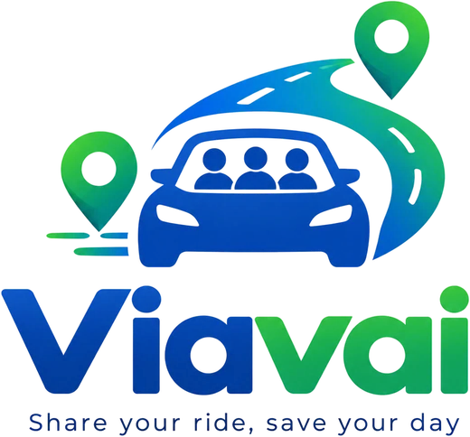

  

Project Plan di sviluppo del software: Viavai, un'applicazione web di carpooling per gli spostamenti quotidiani brevi, che mette in contatto passeggeri e conducenti che fanno la stessa strada ogni giorno, per dividere le spese del viaggio.

Sviluppato da:

- Meriame Benantar, 1087369
- Zineb Machal, 1100565
- Zineb Chakraoui, 1086381

 

Corso di Ingegneria del Software, A.A. 2026/2027, Università degli Studi di Bergamo. 
Docente: prof. Angelo Gargantini. Esercitatrice: Silvia Bonfanti.

Storico delle versioni:

| Versione | Modifiche |
|---|---|
| 1.1 |Aggiunta la board Kanban nella sezione 5|

# INDICE
1. [Introduzione](#1-introduzione)
2. [Modello di processo](#2-modello-di-processo)
3. [Organizzazione del progetto](#3-organizzazione-del-progetto)
4. [Standard, linee guida, procedure](#4-standard-linee-guida-procedure)
5. [Attività di gestione](#5-attività-di-gestione)
6. [Rischi](#6-rischi)
7. [Personale](#7-personale)
8. [Metodi e tecniche](#8-metodi-e-tecniche)
9. [Garanzia di qualità](#9-garanzia-di-qualità)
10. [Pacchetti di lavoro (workpackages)](#10-pacchetti-di-lavoro-workpackages)
11. [Risorse](#11-risorse)
12. [Budget e programma](#12-budget-e-programma)
13. [Cambiamenti](#13-cambiamenti)
14. [Consegna](#14-consegna)

## 1. Introduzione
Per il progetto del corso di Ingegneria del Software abbiamo deciso di sviluppare Viavai, un'applicazione di carpooling pensata per i tragitti brevi che si fanno tutti i giorni, come casa-università o casa-lavoro. L'idea nasce dalla nostra esperienza di studentesse pendolari: molte persone fanno ogni mattina la stessa strada da sole in macchina, mentre altre la fanno con i mezzi pubblici o cercano un passaggio. Le app che esistono già, come BlaBlaCar, sono pensate soprattutto per viaggi lunghi e occasionali, non per i tragitti brevi e ripetuti.

L'obiettivo del progetto è applicare a un caso concreto quello che vediamo a lezione: raccolta dei requisiti, modellazione UML, progettazione con design pattern, implementazione in Java e testing.

Un vincolo importante del dominio è che Viavai deve restare un servizio di condivisione delle spese e non diventare un servizio di trasporto a pagamento. Per questo il prezzo che un conducente può chiedere ha un limite massimo, calcolato dall'applicazione (vedi [sezione 8](#8-metodi-e-tecniche)).

Il progetto parte con una prima versione pensata per l'area di Bergamo.

Abbiamo scelto un approccio customer-driven, come visto a lezione. Il nostro committente è immaginario: il mobility manager dell'Università di Bergamo, cioè chi si occupa di come studenti e personale raggiungono le sedi. Ci ha spiegato che il parcheggio della sede di Dalmine è spesso pieno e che molti studenti arrivano da soli in auto dagli stessi comuni. Per questo ci chiede un'app per far condividere il viaggio ai pendolari, a patto che resti una condivisione delle spese e non un servizio a pagamento.

Il team di sviluppo è composto da 3 persone: Meriame Benantar, Zineb Machal e Zineb Chakraoui.

#### 1.1 Utente tipo
L'utente tipo è uno studente o un giovane lavoratore che fa ogni giorno lo stesso tragitto. Ad esempio Marco, 24 anni, studia Ingegneria a Dalmine e parte ogni mattina da Seriate: vorrebbe spendere meno di benzina dividendo il viaggio con altri studenti che fanno la sua stessa strada.

#### 1.2 Ambito della prima versione
Nella prima versione vogliamo realizzare queste funzionalità:

- registrazione e accesso, scegliendo il ruolo di passeggero o di conducente;
- pubblicazione di un passaggio ricorrente da parte del conducente (partenza, arrivo, orario, giorni della settimana, posti liberi, prezzo);
- ricerca di un passaggio e richiesta di un posto da parte del passeggero;
- accettazione o rifiuto delle richieste da parte del conducente;
- controllo automatico del prezzo massimo;
- notifiche quando cambia lo stato di una prenotazione;
- interfaccia in italiano e in inglese.

Abbiamo deciso di lasciare fuori dalla prima versione (sono i nostri requisiti "won't have"):

- i pagamenti dentro l'app: il passeggero paga il conducente direttamente, in contanti;
- il GPS in tempo reale durante il viaggio;
- un'app mobile nativa: Viavai è un'applicazione web, che però si adatta anche allo schermo del telefono;
- i servizi esterni di mappe, perché il corso chiede di non usare servizi esterni da installare.

Non usando le mappe, non calcoliamo le distanze in modo dinamico. Abbiamo diviso Bergamo e i comuni vicini in un certo numero di zone (per esempio Seriate, Dalmine, Treviolo, Città Alta) e salviamo nel database la distanza in km tra ogni coppia di zone. Da questa distanza parte il calcolo del prezzo massimo.

#### 1.3 Relazione con la documentazione finale
Questo project plan è il primo dei documenti richiesti dal corso. Lo consegniamo a parte, perché deve essere approvato prima di iniziare. Tutta l'altra documentazione la raccoglieremo invece in un unico PDF diviso in capitoli, descritto nella [sezione 14](#14-consegna).

## 2. Modello di processo
Abbiamo scelto un modello di sviluppo incrementale e iterativo, organizzato in quattro sprint. Ogni sprint aggiunge una parte del sistema e alla fine di ognuno abbiamo una versione che funziona, anche se incompleta.

Non abbiamo scelto un modello completamente agile perché il corso chiede una documentazione completa (requisiti, diagrammi UML, architettura, test), che non vogliamo lasciare alla fine. Come indicato nei requisiti del corso, pensiamo di dedicare almeno il 70% del tempo a requisiti, modellazione e progettazione. I primi due sprint sono quelli più dedicati a queste attività, ma i diagrammi e i documenti verranno aggiornati anche dopo, quando il codice cambia.

Seguiamo anche in parte l'approccio Model Driven Architecture (MDA) visto a lezione: disegniamo il diagramma delle classi in StarUML e da lì generiamo una prima versione delle classi Java, che poi completiamo a mano. Nella relazione finale indicheremo quali classi sono state generate.

#### 2.1 Sprint
Gli sprint sono quattro e si svolgono in questo ordine:

- Sprint 1, requisiti: raccolta e specifica dei requisiti, diagramma dei casi d'uso, prima versione del project plan, creazione del repository GitHub.
- Sprint 2, modello e dati: diagramma delle classi in StarUML con generazione del codice, database e classi principali (User, Ride, Booking, Vehicle, Zone), diagramma di stato e diagramma delle attività.
- Sprint 3, servizi: logica dell'applicazione, controllo del prezzo, registrazione e accesso, API REST, diagramma di sequenza e diagramma di comunicazione.
- Sprint 4, interfaccia e test: pagine web, notifiche, traduzione italiano/inglese, test di unità e di integrazione, copertura dei test, completamento della documentazione.

#### 2.2 Raccolta dei requisiti
Il committente è immaginario, quindi a turno una di noi fa la sua parte durante la raccolta dei requisiti. I requisiti iniziali li abbiamo ricavati dalle richieste del committente, dalla nostra esperienza di pendolari e dal confronto con app simili, come BlaBlaCar (vedi [sezione 8.2](#82-ingegneria-dei-requisiti)).

## 3. Organizzazione del progetto
Per i requisiti il nostro riferimento è il committente (il mobility manager immaginario, vedi [sezione 1](#1-introduzione)). Per tutto il resto il riferimento sono i docenti del corso, che approvano il progetto. Comunichiamo con loro tramite le issue di GitHub, assegnate agli account `garganti` e `silviabonfanti`, come indicato nei requisiti del corso. Per esempio, per chiedere l'approvazione di questo project plan apriremo una issue assegnata al professore.

**Ruoli:**

Nel nostro team non c'è una gerarchia e non c'è una divisione fissa dei compiti: lavoriamo tutte insieme su tutte le parti del progetto (requisiti, diagrammi, codice, test e documentazione). L'organizzazione è quindi simile a quella di un team agile, come descritto nel capitolo 5 del libro. All'inizio di ogni sprint decidiamo insieme le attività e ognuna prende quelle che riesce a fare in quel momento.

Questo richiede un po' di autodisciplina e una buona comunicazione tra di noi, ma essendo solo in tre pensiamo che sia il modo più semplice di lavorare.

Il lavoro di ciascuna resta comunque visibile dalla cronologia dei commit, dai branch e dalle issue su GitHub.

Conoscenze minime richieste: programmazione in Java e uso di base di Git.

## 4. Standard, linee guida, procedure
Per fare in modo che il progetto sia comprensibile per tutte e facile da mantenere, seguiamo alcune regole comuni.

#### 4.1 Standard di codifica
Seguiamo le convenzioni Java di Oracle:

- Nomi:
	- classi e interfacce in PascalCase (per esempio `RideService`, `PricingStrategy`);
	- metodi e variabili in camelCase, senza underscore;
	- costanti `static final` in MAIUSCOLO, con underscore tra le parole (per esempio `EUR_PER_KM`);
	- package in minuscolo, tutti sotto `it.unibg.viavai`.
- Indentazione: 4 spazi per livello.
- Commenti:
	- commenti inline (`//`) solo dove la logica non è evidente;
	- Javadoc per le classi, le interfacce e i metodi pubblici.
- Nel codice vogliamo usare bene le caratteristiche di Java viste a lezione: visibilità (`private`, `public`) per nascondere i dettagli, interfacce e classi astratte, ereditarietà e polimorfismo (`@Override`), e dove ha senso anche costrutti più recenti come `record`, `Optional` e gli stream.
- Nel codice non devono esserci percorsi assoluti legati al computer di una di noi.

#### 4.2 Linee guida per la documentazione
- Scriviamo la documentazione man mano, nella cartella `documenti/` del repository. Il project plan resta un documento a parte, mentre tutto il resto alla fine lo raccogliamo in un unico PDF diviso in capitoli.
- La lingua è l'italiano.
- Il progetto StarUML con tutti i diagrammi è salvato nel repository (`documenti/uml/viavai.mdj`), insieme alle immagini dei diagrammi usate nella relazione.
- Se un punto della documentazione viene tolto, non rinumeriamo gli altri, così i riferimenti restano corretti.

#### 4.3 Procedure di gestione del codice
Il codice è gestito su GitHub:

- il branch `main` contiene solo versioni che funzionano, mentre ogni nuova funzionalità si sviluppa in un branch separato;
- ogni modifica entra in `main` con una pull request, controllata da almeno un'altra persona del team;
- i messaggi dei commit dicono in modo chiaro cosa è stato fatto;
- il `.gitignore` esclude i file generati, ma non i file `.project`, che servono per importare i progetti in Eclipse.

#### 4.4 Standard di design
L'applicazione è divisa in tre livelli: presentazione (pagine JSP), logica dell'applicazione e accesso ai dati, con il database H2 embedded. Il codice è diviso in due progetti Eclipse con il prefisso `VVI_`, come chiesto dal corso: `VVI_core` e `VVI_webapp`.

Disegneremo in StarUML tutti i diagrammi UML visti a lezione: casi d'uso, classi, macchina a stati, sequenza, comunicazione, attività, componenti e package. Nel capitolo sul design descriveremo l'architettura con almeno due viste.

#### 4.5 Procedure di testing
Durante lo sviluppo facciamo tre tipi di test:

- test di unità, sulle singole classi, soprattutto sui servizi (con Mockito al posto del database);
- test di integrazione, sugli endpoint REST e sulle pagine, con il supporto ai test di Spring Boot e un database H2 in memoria;
- test di sistema, usando noi l'applicazione con dati di esempio (zone, utenti e passaggi), come farebbe un utente.

I test sono in una cartella separata (`src/test/java`), con la stessa struttura dei package del codice.

#### 4.6 Procedure di comunicazione
- Usiamo un gruppo WhatsApp per organizzarci giorno per giorno.
- Le discussioni su una singola attività le scriviamo nei commenti della issue su GitHub, così restano vicine al lavoro.
- Quando serve decidere qualcosa insieme, ad esempio all'inizio di uno sprint, facciamo una breve videochiamata.

## 5. Attività di gestione
Non abbiamo riunioni fisse ogni settimana. Ci aggiorniamo in modo asincrono, sul gruppo e su GitHub, e ci sentiamo quando serve.

Utilizziamo la Kanban board integrata su GitHub (GitHub Projects), tenendo traccia di:

- task assolutamente da svolgere (must have);
- task in fase di implementazione (in progress);
- task in fase di verifica e test;
- task terminate (done);
- task possibili da svolgere in futuro, ma non necessarie (could have).
  
Ogni attività è una issue, con una sola scheda sulla board, ed è assegnata a chi la prende in carico. Usiamo le etichette `bug`, `enhancement`, `documentation` e `question`. Le issue hanno anche un'etichetta di priorità secondo il metodo MoSCoW (must, should, could), così sulla board si vede subito cosa fare prima.

## 6. Rischi
#### 6.1 Meno tempo disponibile per lo studio di altri esami
Soluzione: fare la parte più pesante di sviluppo nei primi sprint e lasciare per l'ultimo le attività più leggere (test, refactoring, documentazione). Lavorando tutte su tutto, se una di noi ha meno tempo per qualche giorno le altre possono continuare il suo lavoro.

#### 6.2 Difficoltà con StarUML e con la generazione del codice
Soluzione: all'inizio del primo sprint dedichiamo un paio d'ore a provare StarUML su un esempio piccolo, prima di usarlo per il progetto.

#### 6.3 La generazione del codice da StarUML potrebbe sovrascrivere il codice scritto a mano
Soluzione: dove possibile teniamo separato il codice generato da quello scritto a mano e rigeneriamo il codice solo dopo aver fatto commit delle modifiche.

#### 6.4 Tecnologie nuove per il team (Spring Boot, JSP, Spring Security)
Soluzione: studiare la documentazione ufficiale e qualche esempio prima di iniziare ogni sprint, e partire da piccoli prototipi.

#### 6.5 Limiti del database H2
Soluzione: usiamo H2 salvato su file per la demo e H2 in memoria per i test. Tutto l'accesso ai dati passa da Spring Data JPA, senza scrivere SQL specifico.

#### 6.6 Comportamento diverso su browser e telefoni
Soluzione: provare l'applicazione fin dall'inizio sia sul computer sia sul browser del telefono.

#### 6.7 Testi tradotti solo in parte
Soluzione: scrivere tutti i testi dell'interfaccia nei file `messages.properties` (inglese) e `messages_it.properties` (italiano) fin dalla prima pagina, invece di tradurre tutto alla fine.

#### 6.8 Perdita di lavoro per un problema al computer
Soluzione: fare commit e push spesso, almeno una volta al giorno quando lavoriamo.

#### 6.9 Aggiungere troppe funzionalità (scope creep)
Soluzione: le nuove idee vengono scritte sulla board come could-have e non entrano nella prima versione.

#### 6.10 Sessioni d'esame diverse tra di noi
Soluzione: decidere presto in quale sessione ognuna farà l'esame e organizzare la consegna sulla sessione più vicina.

## 7. Personale
Il team è formato da tre persone. Secondo le indicazioni del corso, ognuna dovrebbe dedicare al progetto circa 30-40 ore, quindi in totale prevediamo tra le 90 e le 120 ore. Non ci sono persone esterne al team.

Non avendo ruoli fissi, durante il progetto ognuna di noi coprirà più ruoli: analista, progettista, sviluppatrice e tester. Sappiamo che alla fine del progetto ognuna valuterà in privato l'impegno proprio e delle altre, come previsto dal corso. Per i rischi legati al personale vedi i punti [6.1](#61-meno-tempo-disponibile-per-lo-studio-di-altri-esami) e [6.10](#610-sessioni-desame-diverse-tra-di-noi).

## 8. Metodi e tecniche
#### 8.1 Metodologia di sviluppo
Seguiamo il modello incrementale e iterativo descritto nella [sezione 2](#2-modello-di-processo), con una parte di MDA tramite StarUML.

#### 8.2 Ingegneria dei requisiti
Per i requisiti seguiamo il processo visto a lezione: elicitazione, specifica, validazione e negoziazione con il committente, ripetendolo a ogni sprint.

Per l'elicitazione usiamo soprattutto le interviste con il committente e gli scenari, che poi diventano i casi d'uso. In più guardiamo le app già esistenti e facciamo brainstorming tra di noi. Per evitare ambiguità prepariamo anche un glossario con i termini principali (per esempio passaggio, prenotazione, zona).

Per le priorità usiamo il metodo MoSCoW, scrivendo anche i requisiti "won't have", cioè quelli che abbiamo valutato ma che non faremo. Le priorità le negoziamo con il committente: per esempio, i pagamenti dentro l'app gli sarebbero piaciuti, ma li abbiamo messi tra i "won't have" perché richiedono troppo tempo per questo progetto. Per alcune funzionalità useremo anche il modello di Kano, per capire quali l'utente dà per scontate e quali invece sono un valore in più.

I requisiti saranno scritti nel capitolo dei requisiti seguendo lo standard IEEE 830 e prendendo come esempio il documento del ventilatore polmonare visto a lezione. Li scriveremo in tabelle: per ogni requisito ci saranno un identificativo (per esempio FUN.1 per i requisiti funzionali e GUI.1 per quelli dell'interfaccia), la descrizione con la motivazione e i requisiti da cui dipende. Cerchiamo di scrivere un solo requisito per riga e solo requisiti verificabili, così ognuno si può modificare senza toccare gli altri e si può ritrovare nel design e nei test. Alla fine di ogni sprint il committente rilegge i requisiti e li approva (validazione).

#### 8.3 Modellazione
Useremo tutti i diagrammi UML visti a lezione, elencati nella [sezione 4.4](#44-standard-di-design). Per il diagramma di macchina a stati abbiamo scelto la prenotazione (Booking), che passa per gli stati: richiesta, confermata, in corso, completata, rifiutata, annullata e scaduta.

#### 8.4 Design pattern
Pensiamo di usare questi design pattern:

- Strategy, per calcolare il prezzo massimo di un passaggio. Il prezzo massimo per persona è: km × 0,20 € ÷ numero di persone in auto, conducente compreso. Abbiamo preso 0,20 €/km perché è circa il valore più basso delle tabelle ACI per un'auto piccola. Per esempio, da Seriate a Dalmine (14 km) con 3 passeggeri il prezzo massimo è (14 × 0,20) ÷ 4 = 0,70 € a viaggio. Il calcolo è nella classe `CostSharingPricingStrategy`, che implementa l'interfaccia `PricingStrategy`: così in futuro si può aggiungere un'altra regola senza cambiare il codice esistente.
- Observer, per avvisare passeggeri e conducenti quando cambia lo stato di una prenotazione (per esempio quando una richiesta viene accettata o un passaggio viene annullato). In questo modo il servizio delle prenotazioni non dipende da come viene mostrata la notifica.
- Builder, per creare gli oggetti Ride. Un passaggio ha alcuni campi obbligatori (partenza, arrivo, orario, giorni, posti, prezzo) e altri facoltativi (punto d'incontro, note, pedaggi, bagagli): con la classe `RideBuilder` si evita un costruttore con troppi parametri.

#### 8.5 Strumenti
- IDE: Eclipse, con Maven per le dipendenze.
- Modellazione UML: StarUML 5, con l'estensione per generare codice Java.
- Versionamento: Git e GitHub.
- Analisi del codice: SonarLint e PMD.
- Prova delle API REST: Postman.

#### 8.6 Testing
Per i test usiamo JUnit 5 e Mockito, e JaCoCo per misurare la copertura. Oltre ai test sui servizi, vogliamo scrivere alcuni test specifici per i design pattern:

- per `CostSharingPricingStrategy`: prezzo uguale al limite, prezzo appena sopra il limite e distanza zero;
- per l'Observer: verificare che venga avvisato chi è registrato quando cambia lo stato di una prenotazione;
- per `RideBuilder`: verificare che non si possa creare un Ride se manca un campo obbligatorio.

## 9. Garanzia di qualità
#### 9.1 Codifica
Vedi gli standard di codifica nella [sezione 4.1](#41-standard-di-codifica).

#### 9.2 Testing
Vedi la [sezione 4.5](#45-procedure-di-testing). Prima di unire una pull request controlliamo il report di JaCoCo. Non abbiamo un controllo automatico, ma vorremmo arrivare a una copertura dei servizi intorno al 60-70%.

#### 9.3 Analisi del codice
Usiamo SonarLint o PMD per trovare problemi nel codice e per controllare che non ci siano cicli tra i package. Nella relazione finale riporteremo anche alcune metriche del codice e, per una piccola parte, la complessità ciclomatica di McCabe.

#### 9.4 Revisione del codice
Ogni pull request viene controllata da almeno un'altra persona del team prima di entrare in `main`.

#### 9.5 Qualità che ci interessano di più
- Correttezza: il prezzo non deve mai superare il limite.
- Usabilità: l'app deve essere semplice da usare anche dal telefono.
- Manutenibilità: codice diviso in livelli e package senza cicli.
- Portabilità: il progetto deve partire su qualsiasi computer con Java e Maven, senza installare altro.

#### 9.6 Software funzionante
All'esame orale porteremo almeno un portatile con il progetto pronto, per mostrare l'applicazione o eseguire i test se richiesto.

## 10. Pacchetti di lavoro (workpackages)
Tutti i pacchetti di lavoro sono svolti insieme dal team.

#### WP1 Documentazione e requisiti
- Stesura del project plan e suo aggiornamento quando cambia qualcosa (vedi [sezione 13](#13-cambiamenti)).
- Specifica dei requisiti e casi d'uso.

#### WP2 Modellazione UML
- Tutti i diagrammi elencati nella [sezione 4.4](#44-standard-di-design), nel progetto StarUML.

#### WP3 Database e accesso ai dati
- Classi del dominio, repository e configurazione di H2.
- Dati iniziali: zone, distanze tra le zone, qualche utente e passaggio di esempio.

#### WP4 Logica dell'applicazione
- Servizi per utenti, passaggi e prenotazioni.
- Design pattern Strategy, Observer e Builder.

#### WP5 Interfaccia web
- Pagine JSP: presentazione iniziale, scelta del ruolo, registrazione, ricerca, dettaglio del passaggio, pubblicazione, prenotazioni, richieste e pagine di conferma.
- Interfaccia adatta anche al telefono, in italiano e in inglese.

#### WP6 Sicurezza e API REST
- Registrazione e accesso con Spring Security.
- API REST per pubblicare e prenotare i passaggi.

#### WP7 Testing
- Test di unità e di integrazione, copertura con JaCoCo, analisi con SonarLint/PMD.

#### WP8 Manutenzione
- Refactoring e misure del codice, da documentare nella relazione finale.

## 11. Risorse
Hardware:

- i nostri tre portatili;
- connessione a Internet.

Software: vedi la [sezione 8.5](#85-strumenti).

Librerie (gestite con Maven):

- Spring Boot, Spring Data JPA, Spring Security;
- H2, come database embedded;
- JSP e JSTL;
- JUnit 5, Mockito, JaCoCo;
- Log4j2 per i log, come consigliato dal corso.

Il database H2 funziona dentro l'applicazione, quindi non servono server, Docker o altri servizi esterni: basta scaricare il repository e avviare il progetto Maven.

## 12. Budget e programma
Non è previsto un budget economico, trattandosi di un progetto universitario.

Il tempo totale stimato è di 90-120 ore (vedi [sezione 7](#7-personale)), diviso nei quattro sprint della [sezione 2.1](#21-sprint). Le scadenze dipendono dalla sessione d'esame che sceglieremo:

- il project plan sarà pronto almeno un mese prima dell'esame;
- il progetto sarà completo almeno cinque giorni prima della presentazione.

## 13. Cambiamenti
Questo project plan potrà cambiare durante il progetto. Per gestire le modifiche seguiamo questi passi:

- Proposta: chi propone una modifica apre una issue su GitHub, spiegando cosa vuole cambiare e perché.
- Valutazione: ne parliamo insieme e la approviamo solo se è necessaria e rispetta i requisiti, considerando anche quanto tempo richiede e quali parti già fatte tocca.
- Implementazione: la modifica viene fatta seguendo le regole della [sezione 4.3](#43-procedure-di-gestione-del-codice), aggiornando insieme al codice anche la documentazione, i diagrammi e i test collegati.
- Versioni: ogni nuova versione di questo documento viene salvata in `documenti/` con un commit che spiega cosa è cambiato. Grazie a GitHub possiamo sempre tornare a una versione precedente se qualcosa va storto.

Nel capitolo sulla gestione del progetto descriveremo questo processo anche con un piccolo diagramma delle attività UML.

## 14. Consegna
- Il repository GitHub è condiviso con gli account `garganti` e `silviabonfanti`. La documentazione è nella cartella `documenti/` e il codice nella cartella `codice/`, con un README che spiega come avviare il progetto.
- Il project plan viene consegnato almeno un mese prima dell'esame, aprendo una issue di approvazione assegnata al professor Gargantini.
- Il progetto completo viene consegnato almeno cinque giorni prima della presentazione orale.
- Per la presentazione usiamo il template fornito dai docenti; avendo un gruppo di tre persone, abbiamo a disposizione al massimo 30 minuti.

Al committente consegneremo il software funzionante e un unico PDF con tutta la documentazione, mentre il project plan resta un documento a parte. Come nel documento del ventilatore polmonare visto a lezione, il PDF inizierà con le definizioni e le abbreviazioni usate e sarà diviso in questi capitoli:

1. Introduzione
	- 1.1 Viavai
	- 1.2 Struttura del documento
2. Gestione del progetto
	- 2.1 Ciclo di vita del software
	- 2.2 Configuration management
	- 2.3 Organizzazione del team
3. Requisiti
	- 3.1 Raccolta dei requisiti
	- 3.2 Requisiti funzionali
	- 3.3 Requisiti dell'interfaccia
	- 3.4 Requisiti non funzionali
	- 3.5 Qualità del software
4. Design
	- 4.1 Diagrammi UML
	- 4.2 Architettura del software
	- 4.3 Design del software e design pattern
5. Testing
	- 5.1 Casi di test
	- 5.2 Copertura dei test
6. Manutenzione
	- 6.1 Refactoring

---

*Versione 1.1*
