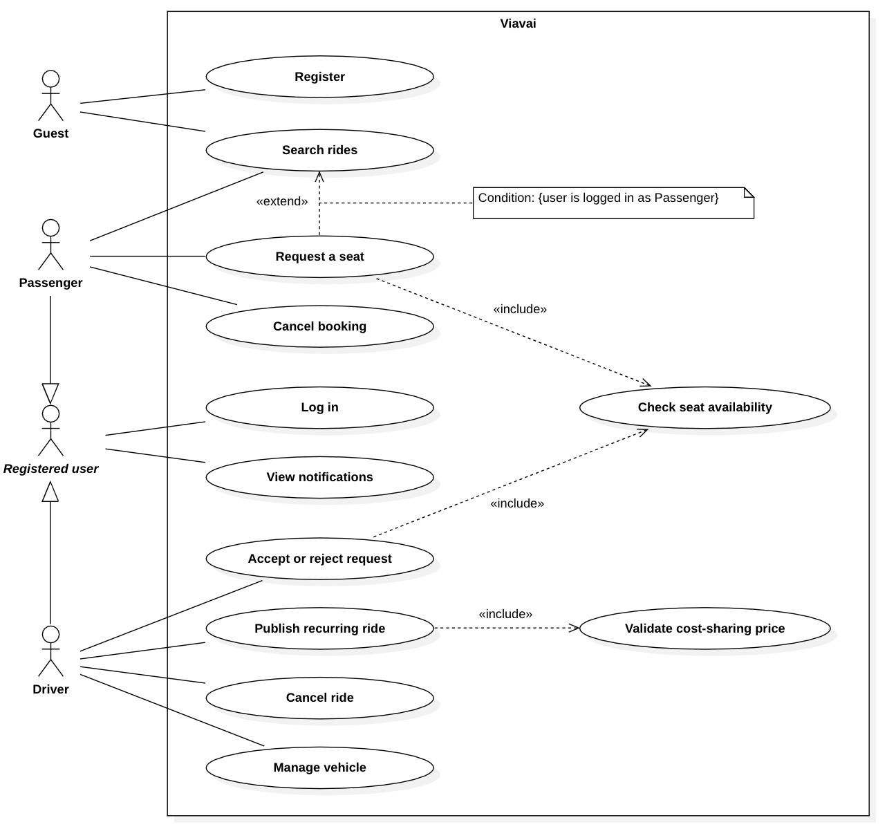

# Progetti StarUML - Viavai

In questa cartella ci sono i file StarUML (`.mdj`) con i diagrammi UML di Viavai. Le immagini dei diagrammi sono nella cartella [immagini](../immagini) e si usano nella documentazione. I file si aprono con StarUML 5 (File → Open).

## Contenuto della cartella

* `usecase.mdj`: diagramma dei casi d'uso (Meriame)
* `class.mdj`: diagramma delle classi, in costruzione (per ora c'è la parte utenti e ruoli, di Meriame)Gli altri file verranno aggiunti durante gli sprint, e questo elenco verrà aggiornato.

## Divisione dei diagrammi

Per ogni diagramma c'è una persona che se ne occupa, con il supporto delle altre per tenere tutto coerente. Il diagramma delle classi lo facciamo insieme, perché da lì nasce il codice.

| Diagramma | Chi se ne occupa | Sprint | Stato |
|---|---|---|---|
| Casi d'uso | Meriame | 1 | fatto |
| Classi | Meriame (utenti e ruoli), Zineb M. (passaggi, zone e prezzo), Zineb C. (prenotazioni e notifiche) | 2 | in corso: fatta la parte utenti e ruoli |
| Macchina a stati (prenotazione) | Zineb M. | 2 | da fare |
| Attività | Zineb C. | 2 | da fare |
| Sequenza | Meriame | 3 | da fare |
| Comunicazione | Zineb M. | 3 | da fare |
| Componenti | Zineb C. | da decidere | da fare |
| Package | Meriame | da decidere | da fare |

## Descrizione dei diagrammi

### Diagramma dei Casi d'Uso (Use Case Diagram)

Il diagramma rappresenta le funzionalità principali di Viavai e le interazioni tra gli attori. Gli attori sono:

* **Guest**, che non ha un account: può registrarsi e cercare i passaggi.
* **Registered user**, un attore astratto (in corsivo nel diagramma) che raccoglie quello che hanno in comune passeggero e conducente: accedere e vedere le notifiche.
* **Passenger**, che cerca un passaggio, chiede un posto e annulla le sue prenotazioni.
* **Driver**, che pubblica i passaggi ricorrenti, accetta o rifiuta le richieste, annulla un passaggio e gestisce il proprio veicolo.

Tra i casi d'uso ci sono tre relazioni:

* `Publish recurring ride` include `Validate cost-sharing price`: ogni volta che si pubblica un passaggio il prezzo viene controllato e non può superare il massimo.
* `Request a seat` e `Accept or reject request` includono `Check seat availability`: i posti liberi si controllano sia quando il passeggero chiede il posto sia quando il conducente accetta.
* `Request a seat` estende `Search rides`: dopo la ricerca il passeggero può chiedere un posto, ma solo se è registrato come passeggero (è la nota nel diagramma).

Ogni caso d'uso corrisponde a uno o più requisiti funzionali:

| Caso d'uso | Requisiti |
|---|---|
| Register | FUN.1, FUN.2 |
| Log in | FUN.3 |
| Manage vehicle | FUN.4 |
| Publish recurring ride | FUN.5, FUN.8 |
| Validate cost-sharing price | FUN.6, FUN.7 |
| Search rides | FUN.9 |
| Request a seat | FUN.10 |
| Accept or reject request | FUN.11 |
| Check seat availability | FUN.10, FUN.11 |
| Cancel booking | FUN.12 |
| View notifications | FUN.13 |
| Cancel ride | FUN.14 |

La scadenza delle richieste (FUN.15) non ha un caso d'uso, perché la fa il sistema da solo, senza un attore.
