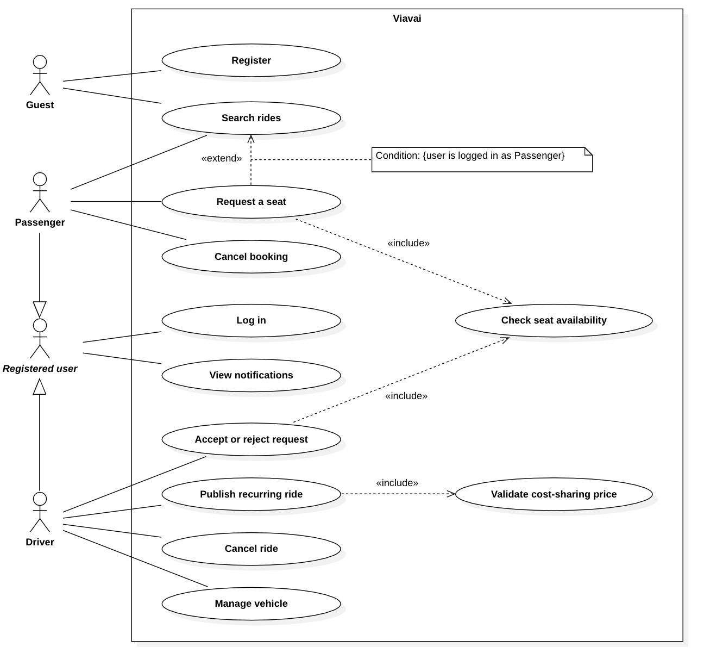

<p align="center"></p>

<h1 align="center">Viavai</h1>

<p align="center"><b>Carpooling per i tragitti di ogni giorno: stessa strada, spese divise.</b></p>

<p align="center">Progetto del corso di Ingegneria del Software · A.A. 2026/2027 · Università degli Studi di Bergamo</p>

---

## L'idea

Molte persone fanno ogni mattina la stessa strada da sole in macchina, mentre altre la fanno con i mezzi pubblici o cercano un passaggio. Le app che esistono già, come BlaBlaCar, sono pensate per viaggi lunghi e occasionali. **Viavai** è un'applicazione web di carpooling per i tragitti brevi e ripetuti, come casa-università o casa-lavoro, pensata per l'area di Bergamo.

Viavai deve restare una condivisione delle spese e non un servizio a pagamento: per questo il prezzo che un conducente può chiedere ha un limite massimo, calcolato dall'app come **km × 0,20 € ÷ persone in auto** (conducente compreso). Per esempio, da Seriate a Dalmine (14 km) con 3 passeggeri il massimo è (14 × 0,20) ÷ 4 = 0,70 €.

## Come funziona

1. Il **conducente** pubblica un passaggio ricorrente: zona di partenza e di arrivo, orario, giorni della settimana, posti liberi e prezzo.
2. Il **passeggero** cerca un passaggio sulla sua strada e chiede un posto.
3. Il conducente **accetta o rifiuta** la richiesta.
4. Tutti e due ricevono una **notifica** quando cambia lo stato della prenotazione.

## La prima versione

- registrazione e accesso, scegliendo il ruolo di conducente o di passeggero
- pubblicazione di passaggi ricorrenti, con controllo automatico del prezzo massimo
- ricerca dei passaggi e richiesta di un posto
- accettazione o rifiuto delle richieste
- notifiche quando cambia lo stato di una prenotazione
- interfaccia in italiano e in inglese, utilizzabile anche dal telefono

Non fanno parte della prima versione: i pagamenti dentro l'app (il passeggero paga il conducente in contanti), il GPS in tempo reale, un'app mobile nativa e i servizi esterni di mappe.

## Tecnologie previste

| Cosa | Con cosa |
|---|---|
| Applicazione web | Java, Spring Boot, pagine JSP |
| Sicurezza e API | Spring Security, API REST |
| Dati | database H2 (incluso nel progetto) con Spring Data JPA |
| Build e IDE | Maven, Eclipse |
| Test e qualità | JUnit 5, Mockito, JaCoCo, SonarLint, PMD |
| Modellazione | StarUML 5, con generazione del codice Java |
| Lavoro di squadra | Git, GitHub, issue e Kanban board |

## Documentazione

| Documento | Cosa contiene |
|---|---|
| [Project plan](Documenti/ProjectPlan.md) | modello di sviluppo, organizzazione, rischi, tempi e regole del progetto |
| [Documentazione](Documenti/Documentazione.md) | introduzione, gestione del progetto, requisiti, design, testing e manutenzione |
| [Diagrammi UML](Documenti/uml) | i progetti StarUML, con la descrizione di ogni diagramma |

Un esempio, il diagramma dei casi d'uso:

<p align="center"></p>

## Come lavoriamo

- Lavoriamo per **sprint**, con un modello incrementale e iterativo: requisiti, modello e dati, servizi, interfaccia e test.
- Ogni attività è una **issue**, con una scheda sulla board Kanban di GitHub Projects.
- Il branch `main` contiene solo versioni che funzionano. Ogni funzionalità del codice si sviluppa in un branch e entra con una **pull request** controllata da un'altra di noi.
- I commit dicono cosa abbiamo scritto o aggiornato.

## A che punto siamo

| Sprint | Contenuto | Stato |
|---|---|---|
| 1 | Requisiti | in corso |
| 2 | Modello e dati | da fare |
| 3 | Servizi | da fare |
| 4 | Interfaccia e test | da fare |

Lo stato di ogni attività si vede dalla board del progetto e dalle issue.

## Come avviare il progetto

Il codice non c'è ancora: lo aggiungeremo negli sprint 2 e 3. Quando sarà pronto, spiegheremo qui come avviarlo. Serviranno solo **Java** e **Maven**, senza installare altro.

## Struttura del repository

```text
.
├── Documenti
│   ├── ProjectPlan.md           project plan
│   ├── Viavai_ProjectPlan.pdf   project plan in PDF
│   ├── Documentazione.md        documentazione del progetto
│   ├── immagini                 logo e immagini dei diagrammi
│   └── uml                      progetti StarUML e descrizione dei diagrammi
└── README.md
```

## Il team

| Nome | GitHub |
|---|---|
| Meriame Benantar | [Mariaaa581](https://github.com/Mariaaa581) |
| Zineb Machal | [zinebmachal04](https://github.com/zinebmachal04) |
| Zineb Chakraoui | [zinebchakraoui](https://github.com/zinebchakraoui) |

Docente: prof. Angelo Gargantini · Esercitatrice: Silvia Bonfanti
